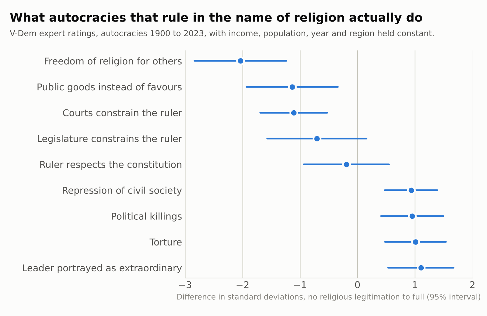
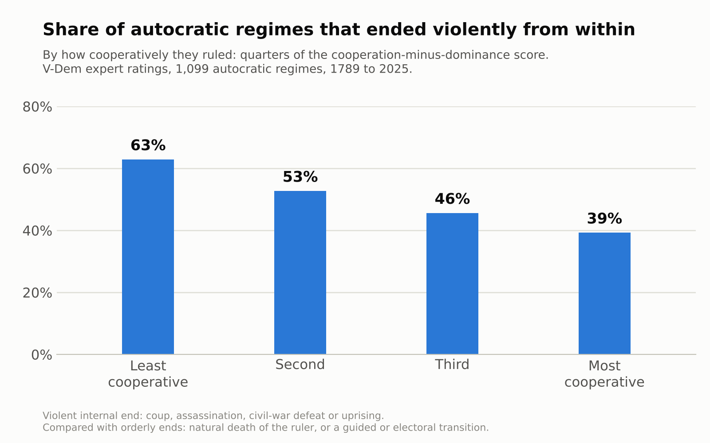

# Narrative Selection and Societal Endurance: Results by Hypothesis

Exploratory run, 16 to 23 October 2026. Companion to the protocol, whose Sections 12 to 15 log the deviations and results. Author: Hamza Bassatné. Data collection, coding and analysis were carried out with the assistance of Claude (Anthropic).

## How to read this report

Every result here is exploratory. The protocol was not peer reviewed before the run, the plans were frozen only in Drive, and every judgement-based code (how a polity ended, whether conquerors adopted a tradition, how an ethnography evaluates a behaviour) was made by independent instances of one AI model, with no human coder validating them. Agreement between those instances measures the model's consistency, not human reliability. The narrative-content scores come from a published word list (the Morality-as-Cooperation Dictionary, MAC-D), which needs no judgement and is blind to outcomes, but measures how often moral domains are mentioned rather than whether a text endorses them.

For each hypothesis the report gives: what it claims; what was done; the result; why it came out that way; and how it could be tested better. Hazard ratios (HR) below 1 mean longer survival; odds ratios (OR) above 1 mean higher odds; 95 percent confidence intervals are in brackets.

## Summary

- H1, moral content predicts endurance: not supported. HR 1.08 per SD [0.90, 1.28]; a protective effect stronger than about 0.90 is ruled out, a small one is not.
- H2, robust to drivers of power: not supported. HR 1.08 [0.92, 1.25] after controls.
- H3, content precedes complexity: not testable with a content score that is constant within a tradition.
- H4a, content prevents internal collapse rather than conquest: not supported. Internal-collapse HR 1.15 [0.80, 1.66].
- H4b, conquerors adopt high-content traditions: not supported. In 61 conquests across traditions, conquerors adopted the conquered tradition fully in 5 and partly in 16, and adoption was, if anything, less likely for high-content traditions (odds ratio 0.60 [0.31, 1.15]). Adoption tracked the conquerors: peoples without a codified religion adopted in 11 of 15 cases, while Christian and Muslim conquerors kept their own in 23 of 26.
- H5, content works apart from belief in moralizing gods: no content effect for the vessel to absorb.
- H6, reading high-content stories raises trust in strangers: not run (needs a real experiment).
- H7, the same effect in every era: uninterpretable; the earliest era rests on two traditions.
- H8, service-legitimated rule outlasts force: the original proxy failed, but the revised test supports part of the claim. Belief that rulers answer to divine morality did not protect polities, and crises under it more often ended in removals, which came with civil war, not reform. Measured by what rulers do (V-Dem, 1,600 autocratic regimes since 1789), cooperative rule did not last longer, but it ended violently far less often (39 versus 63 percent) and was followed by faster growth and longer lives. Civil wars and coups did not differ. Regimes legitimated by religion behave like dominance regimes.
- H9a, the seven cooperative behaviours are judged good everywhere: not falsified. In a new sample of 30 societies, 200 of 203 stated judgements were positive (98.5 percent), and no behaviour was judged bad more than 2.8 percent of the time. The three exceptions mark the edge of the group, such as stealing from enemies. The evidence is thin, though: with 11 to 50 judgements per behaviour, condemnation rates of up to 10 to 26 percent cannot be ruled out.
- H9b, belief in a moralizing God spreads by descent and scale: supported. Strong phylogenetic clustering (D = -0.20) and a steep rise with political scale.
- Study 2, folklore content and trust: the content score does not predict trust across countries or among second-generation immigrants (an effect of 0.10 SD or more is ruled out there), and shows a weak positive tendency with political scale.

## Data and methods common to all tests

Polities: the current public Seshat Global History Databank release (864 polities), downloaded 17 October 2026. Of these, 430 enter at least one model; 429 endings were coded under the Termination-Type Codebook v0.3 (continuity 164, conquest 163, internal collapse 67, absorption 11, other 6, insufficient evidence 18). A random 20 percent was coded twice: agreement on termination type was 79 of 86 (Krippendorff alpha 0.89). An audit of 20 random codes found that the cited pages fully supported 16 and partly supported 4.

Narrative content: 15 traditions, each scored on the public-domain English translation of its canonical texts (for example the King James Bible, the JPS 1917 Tanakh, Rodwell's Qur'an, Griffith's Rig Veda, the Kojiki, the Avesta). The Cooperative Content Index (CCI) is the mean, across the seven MAC-D domains (family, group, reciprocity, heroism, deference, fairness, property), of the standardized rate of virtue words per 10,000 words. Polities take the score of their dominant religion's tradition.

Models: Cox proportional-hazards and Fine-Gray competing-risk models, 50 multiple imputations for missing covariates, standard errors clustered by tradition, and permutation tests that shuffle scores across traditions, because the score varies only between traditions. An independent script reproduced the main sample and estimate exactly. Two further verification runs re-derived the Study 2, CrisisDB, V-Dem, H4b and H9a numbers from the raw data with separately written code; all reproduced, and the errors found are corrected and logged in the protocol (Deviation D22).

## H1: moral content predicts endurance

### Claim

Polities whose narrative tradition carries more cooperative moral content last longer.

### What was done

253 polities with a scored tradition and a known ending, 176 terminations. Cox model of time from polity start to non-continuous termination on the CCI.

### Result

HR 1.08 per SD [0.90, 1.28]; permutation p = 0.51. Not supported. The 90 percent interval [0.93, 1.25] crosses the equivalence bound of 1.11, so equivalence to zero is not established either. Sensitivity analyses gave 0.95 to 1.16; dropping one tradition at a time gave 0.96 (without Islam) to 1.14. Across 72 specifications, none showed a significant protective effect and 7 (all assigning traditions by official rather than widespread religion) showed a significant harmful one.

### Why it came out this way

Five features of the data shape this result. First, the score varies only across 15 traditions, so the effective sample is 15, not 253; a real but modest effect would be invisible. Second, the dictionary counts how often moral words appear, which is not the same as endorsing cooperation: the Kojiki scores highest because its genealogies are full of kinship words. Third, most polities are assigned the canon of a world religion they shared with very different neighbours (Islamic, Christian and Hindu polities span centuries and continents), which compresses real differences in lived narrative. Fourth, two thirds of endings were conquests, which depend on neighbours' armies more than on internal cohesion. Fifth, Seshat polity boundaries often mark periodizations rather than real ends; coding them as continuity helps, but durations remain noisy.

### How to test it better

- Score content by endorsement, not word frequency: trained human coders rating redacted passages (protocol Section 5), or a validated classifier checked against human ratings on a held-out set.
- Measure content at the polity or region level, not the world-religion level: local law codes, court chronicles, popular epics and sermons, dated to the polity's century, so that the score varies within traditions and over time.
- Add oral traditions through folklore (Study 2) to raise the number of independent traditions from 15 to hundreds.
- Use an endurance outcome less driven by conquest, such as recovery after crises (CrisisDB) or the survival of institutions across dynastic changes.

## H2: robust to the drivers of power

### Claim

The H1 effect holds after controlling for agricultural productivity, military technology, population, social complexity, geography and writing.

### What was done

The H1 model with military technology, iron, cavalry, log population, the first principal component of nine Seshat complexity measures, absolute latitude and writing. Agricultural productivity and kinship intensity are not available in the public Seshat API.

### Result

HR 1.08 [0.92, 1.25]; permutation p = 0.47. Not supported. Of the controls, only iron weapons reached significance (HR 2.77 [1.03, 7.42]), meaning iron-using polities ended sooner, probably because they lived in more contested, more militarized regions.

### Why

With no unadjusted effect, adjustment has nothing to explain away. The controls are also polity-level averages rather than century-level values, so they capture differences between polities but not change within them.

### How to test it better

- Obtain the Seshat agricultural-productivity and full military-technology series used by Turchin et al. (2022) and model them as time-varying, century by century.
- Use within-region designs (polities in the same Natural Geographic Area) so that geography and neighbours are held constant.

## H3: content precedes complexity

### Claim

Changes in narrative content come before, not after, changes in social complexity.

### Result

Not tested. The dictionary score is a single number per tradition, so it cannot change within a polity over time, and lags are impossible.

### How to test it better

A dated content series is needed: for example, scoring law codes, inscriptions and court literature century by century within a region (Mesopotamia, Egypt, China and the Mediterranean have dated corpora), then fitting cross-lagged panel models against Seshat's complexity series.

## H4a: internal collapse versus conquest

### Claim

If content matters because it supports social life, it should mainly reduce collapse from within (civil war, fragmentation, revolution), which military power does not prevent, rather than conquest.

### What was done

Fine-Gray and cause-specific Cox models for internal collapse (49 events) and conquest (117 events), adjusted as in H2, with the codebook's sensitivity analyses.

### Result

Internal collapse: sub-hazard ratio 1.15 [0.80, 1.66], permutation p = 0.28. Conquest: 1.04 [0.78, 1.38]. Every codebook variant leaned the other way, most clearly when conquests preceded by an internal crisis were counted as internal collapse: 1.18 [1.00, 1.38]. Not supported.

### Why

Only 49 internal collapses fall in the scored sample, spread over 15 traditions. The slight tendency toward more internal collapse with higher scores is driven by Islamic polities, which score high on the dictionary (many reciprocity words in the Qur'an translation) and include many sultanates that ended in coups and successions.

### How to test it better

The same improvements as H1, plus more internal-collapse events: coding the remaining 434 Seshat polities and the CrisisDB crises that did not end a polity, which would roughly double the events.

## H4b: conquerors adopt the narratives of the conquered

### Claim

If cooperative content is what makes a tradition fit, conquerors should tend to adopt the traditions of the peoples they conquer when those traditions carry more of it (reverse transmission). The classic examples are the Mongols becoming Muslims in Iran and the Manchus becoming Confucian rulers of China.

### What was done

All 117 conquests in the Study 1 sample whose conquered population had a scored tradition were coded by independent AI coders, blind to the content scores. For each conquest they recorded three things: the conquering elite's own tradition; whether it adopted the conquered tradition as its own within 100 years (yes, partly, no); and whether the conquering elite used writing. A random 23 episodes were coded twice. The coders agreed on adoption in 22 (alpha 0.93), and a third coder settled the two disagreements. A separate auditor opened the cited sources for 15 random episodes. They fully supported the codes in 10 and partly in 5, and contradicted none. The partial cases include the Qing, where one source names Tibetan Buddhism rather than shamanism as the Manchus' main religion; adoption of Confucian orthodoxy is coded either way. In 55 conquests the conquerors already shared the tradition, so nothing could be adopted. The pre-specified test is a logistic regression of adoption on the conquered tradition's content score, controlling for the conquered polity's complexity and writing and the conquerors' writing. Inference uses a permutation test that shuffles scores across traditions.

### Result

Of the 61 conquests across traditions, the conquerors fully adopted the conquered tradition in 5 and partly in 16; in 39 they kept their own, and 1 is unknown. With only 5 full adoptions, the primary model could not be fitted (the plan required 10). The pre-specified permutation test of the association was null: r = +0.04, p = 0.84. Counting partial adoption as adoption (21 of 57), the odds ratio was 0.60 per SD of content [0.31, 1.15], with permutation p = 0.39. This is in the opposite direction to the prediction, though not significant. By the plan's literal rule (an odds ratio below 1), H4b is not supported. The pattern by tradition shows why. Conquerors of Buddhist populations adopted Buddhism, at least partly, in 6 of 10 conquests, although Buddhism has the lowest content score. Conquerors of Muslim populations did so in 1 of 12, although Islam's score is second highest. Most of those 12 conquerors were Christian colonial powers or Christian Ethiopia.

### Why

Who adopted whom depended on the conquerors, not on the content of the conquered tradition. Conquerors who brought little codified religion of their own (steppe peoples, Kassites, Gutians, Mongols, Manchus) adopted the conquered tradition fully or partly in 11 of 15 conquests. These are the classic cases the hypothesis is built on, but what they show is that a literate, organized tradition absorbs unlettered conquerors. Conquerors who already carried a scriptural religion kept it. Christian conquerors kept theirs in 12 of 13 cases, and Muslim conquerors in 11 of 13; the two Muslim exceptions are the Mughals' partial patronage of Hindu traditions. The sample is also small: 9 to 10 traditions carry all the variation, and the content score is the weak word-count measure discussed under H1.

### How to test it better

- Measure the conquerors' starting point: whether their own tradition was written, codified and exclusive. The theory predicts adoption only where the conquerors' tradition is weaker in content than the one they meet, so the comparison should be conqueror versus conquered, which needs content scores for steppe and tribal traditions as well.
- Code adoption of specific narrative elements (law codes, founding myths, moral exemplars) rather than of whole religions, since conquerors often keep their religion while adopting the law and literature of the conquered (Romans and Greek literature, the Normans and English law).
- Extend beyond Seshat to every documented elite conversion (for example the Christianization of Germanic and Slavic rulers, the Islamization of Turkic dynasties) to reach a few hundred episodes.

## H5: content versus belief in moralizing gods

### Claim

Content predicts endurance independently of whether the society believes in moralizing gods.

### Result

With Seshat's moralizing supernatural punishment variable added, the CCI estimate is unchanged (HR 1.07 [0.93, 1.24]). Since there is no CCI effect to begin with, this does not show independence. The punishment variable itself is uninformative (HR 8.0 [0.8, 80]) because 85 percent of coded polities have it. In Study 2, the folklore score's tendency toward larger political scale was also unchanged when high-god belief was controlled.

### How to test it better

Needs a content effect first. With one, compare its size with and without belief variables in samples where belief varies (Study 2 groups vary far more than Seshat's state-level polities).

## H6: reading high-content stories increases trust in strangers

Not run. It requires real participants, ethics approval and incentive payments in at least eight countries; simulated participants would be fabricated data. This remains the only design in the protocol that can establish cause rather than association, and it is the cheapest to run properly: about 1,900 participants online, using matched story pairs from the same tradition and an incentivized trust game.

## H7: the same effect in every era

### Result

Era-specific hazard ratios: 0.58 before 500 BCE (34 polities), 1.03 from 500 BCE to 1500 CE, 1.09 after 1500 CE; interaction p = 0.085 after adjustment (Holm-adjusted 0.43). The early estimate rests almost entirely on Mesopotamian (13 polities) and Egyptian (12) traditions, so it compares two traditions, not two eras.

### How to test it better

Only possible once content varies within eras: with polity-level or dated content scores, each era would contain many traditions.

## H8: service-legitimated leadership outlasts force

### Claim

Hierarchies whose rulers are bound by moral law and legitimated by service end less often through internal collapse, and less violently, than hierarchies held by force.

### What was done

No direct measure of service-based leadership exists for these polities. The closest available variable is Seshat's 'moralizing enforcement of rulers': whether rulers were believed subject to supernatural moral sanction (present in 301 of 375 coded polities, absent in 74). Four tests: the original competing-risk models; within-region models (polities compared only with others in the same Natural Geographic Area); literate states only; and all 169 CrisisDB crises, including those that did not end a polity.

### Result

Original: internal-collapse HR 3.04 [1.18, 7.85] unadjusted, 1.32 [0.34, 5.12] adjusted. Within regions: 4.50 [0.50, 40.6]. Literate states: 1.69 [0.51, 5.60]. Crises (135 of the 169 with the consequences coded): severity was not lower where rulers faced moral sanction (0.74 versus 0.54 severe consequences per crisis, p = 0.19), and rulers were far more often deposed or assassinated (67 percent of 109 crises versus 22 percent of 23; odds ratio 7.4 [2.6, 21], p < 0.001). With log population added, as the plan specified but the first script omitted: severity +0.12 (p = 0.51), deposition odds ratio 5.5 [1.6, 18.8], p = 0.006. Not supported in any form.

The best human-coded evidence elsewhere is similarly mixed. Blanton, Feinman, Kowalewski and Fargher (2020) coded good government for 30 premodern states. States with good government lasted slightly longer than authoritarian ones (mean 166 versus 152 years, not significant) and had fewer rebellions and succession crises (Kendall tau-b -0.30, p = 0.04). When they declined, though, the decline was more often major (p = 0.04, 19 states). A follow-up (Blanton and Fargher-Navarro 2024) again finds less social disruption in more collective states (tau-b -0.30, p = 0.03) but reports no durations.

### Why

Two reasons. First, the measure does not match the claim. Believing that heaven judges kings is not the same as kings who serve. The belief is near-universal in states and is missing mainly in small or early polities, so it tracks scale and era. Second, the comparison group is tiny: only 6 internal collapses occurred among the 74 polities without the belief.

### Is a ruler's removal or an internal collapse costly to the society? (follow-up, 23 October)

An earlier draft of this report suggested that the higher deposition rate might mean accountability was working: bad rulers removed while the state survived. That was an interpretation, not a test. It conflicts with the protocol's own reading, in which internal breakdown is a failure. The follow-up tested the question directly. The plan was fixed in h8_followup_plan.md before the outcomes were computed, and two checks added afterwards are labelled as such.

- What comes with removal. In 159 crises with the ruler's fate coded, crises that removed the ruler (by deposition or assassination) more often involved civil war: 66 versus 35 percent, OR 3.6 [1.8, 7.4], Holm p = 0.003. They also more often involved downward mobility of elites (51 versus 32 percent, p = 0.02 before correction). New public goods followed none of the 93 removals, against 5 of 60 other crises (Fisher p = 0.008). Constitutional change was no more common (27 versus 32 percent). Removal behaved like a marker of breakdown, not of reform.
- What happens to the polity. After a removal crisis, the polity ended non-continuously sooner: HR 1.56 [1.04, 2.35], 125 crises, 80 endings. The estimate was unchanged with civil war and extermination controlled (1.53). In 73 percent of removal crises the polity ended within 10 years, against 47 percent of other crises; removal crises were often the terminal crisis. Among polities that outlived the crisis by more than 10 years, the direction held but the estimate was imprecise: HR 1.67 [0.71, 3.96], 47 crises, with median remaining life 48 versus 80 years. This survivor check was added after seeing the results.
- What happens to the society in the region. Each ending was compared with what came next in the same Natural Geographic Area, using continuity (the same society carrying on without a break) as the benchmark. After internal collapse, the successor polity was less complex than after continuity: -0.15 [-0.28, -0.01] on the mean of nine z-scored complexity measures, and -0.22 [-0.41, -0.03] within regions. It also had a smaller territory (-0.47 log10 units [-0.82, -0.12]) and a longer interregnum (+19 years [5, 33]). Conquest showed no such loss of complexity, population or territory (complexity -0.02 [-0.13, 0.08]), only a longer gap. Smaller successor territory after a fragmentation is partly true by definition. With complexity built only from the six institutional measures (hierarchy, government, infrastructure, writing, texts, money), the loss after internal collapse was smaller but kept its direction: -0.11 [-0.22, -0.01], and within regions -0.14 [-0.30, 0.02]. This check was added after seeing the results. The size of the largest settlement did not differ. Regaining the predecessor's complexity took a median of 38 years after internal collapse and 68 after conquest; the time to recovery did not differ significantly (HR 0.82 [0.56, 1.21]).
- Does moral sanction of rulers soften any of this? No. Within polities whose rulers were under moral sanction, removal still predicted an earlier end: HR 1.72 [1.09, 2.72]. The interaction was 0.92 [0.29, 2.86]. The complexity cost of internal collapse did not differ by moral sanction (interaction +0.02 [-0.48, 0.52]), though only 5 internal collapses occurred without it.

Reading. The data support treating removal and internal collapse as failures, not as accountability. Removal comes with civil war and without reform, and it is followed by an earlier end. Internal collapse leaves the region's next polity less complex, in a way conquest does not. On the only proxy available, polities whose rulers were held under divine moral sanction had more of these breakdowns, not fewer. H8 therefore stands as not supported, and no reinterpretation rescues it. Two limits remain. Crises with and without removal differ in more than the removal: a worse crisis may cause both the removal and the later decline, so these comparisons show that removal marks a costly path, not that removal itself causes the cost. And polities absent from CrisisDB are unstudied, not crisis-free.

### Revised test: what rulers do, not what is claimed for them (23 October)

The author's revision changes the exposure. Supporters' claims that a ruler answers to divine morality are often a tribal instrument of power, so they say little about how the ruler behaves. The test should compare rulers who govern by dominance with rulers who govern cooperatively, and follow the long-term effect on their societies. The data are human-coded: V-Dem v15, rated by country experts, covering 1789 to 2025. The sample is 21,576 country-years under autocracy in 202 countries, where rulers face no electoral accountability. The plan (h8r_plan.md) was fixed before the models were run.

Measures. Dominance is the average of political killings, torture and repression of civil society. Cooperation is the average of four things: the executive respecting the constitution, judicial constraints, legislative constraints, and public-goods rather than favour-based spending. The strategy score is cooperation minus dominance, standardized; it measures conduct, not rhetoric. The two parts correlate at -0.66.

### Is divine legitimation a constraint on rulers or a tool of power?

Among autocracies from 1900 to 2023, the analysis compared regimes that legitimate themselves through religion with those that do not. The religious end of the scale includes Saudi Arabia, Iran, Yemen, Sudan, the Gulf monarchies and the Hindu kingdom of Nepal. Effects are for moving from no religious legitimation to full, in standard deviations, first between regions and then within the same country over time:

- Freedom of religion for others: -2.0 [-2.8, -1.2]; within country -1.0 [-1.6, -0.4].
- Political killings: +0.95 [+0.41, +1.49]; within +1.29 [+0.74, +1.84]. Torture: +1.01 [+0.48, +1.54]; within +1.05 [+0.12, +1.99].
- Judicial constraints on the ruler: -1.11 [-1.69, -0.52]; within -0.93 [-1.57, -0.28]. Respect for the constitution: no clear difference.
- Public goods instead of favours: -1.14 [-1.93, -0.34]; within -1.17 [-2.49, +0.15]. Portrayal of the leader as extraordinary (pious, heroic, wise): +1.10 [+0.53, +1.67].

Comparison with other ideologies. Nationalist legitimation also comes with killing, torture and weaker constraints, but not with less religious freedom. Socialist legitimation curbs religion and civil society, but comes with more public goods. Only religious legitimation combines all four: less freedom for other faiths, more killing and torture, weaker courts and fewer public goods. That is the profile the revision anticipated: an in-group identity used to hold power, not a moral law that binds the ruler. This matches Bentzen and Gokmen (2023). Across 1,265 premodern societies, they find that the countries whose rulers relied on divine legitimization are more autocratic today, and their populations are more religious. It also matches the premodern Seshat result above: the belief that rulers answer to divine morality did not make crises less violent. These data cannot show what rulers privately believed, or whether 'most' did so in every era. They show what regimes that claim divine sanction actually do.

<picture>
  <source media="(prefers-color-scheme: dark)" srcset="figures/fig2_religious_legitimation_dark.png">
  
</picture>

### Do cooperative strategies leave societies better off in the long run?

- Prosperity. Per SD more cooperative strategy, GDP per head grew 2.0 percent more over the next 10 years [0.6, 3.5] and 3.1 percent more over 20 years [0.2, 6.0]. Life expectancy rose 0.52 years more over 20 years [0.17, 0.87]. These hold in non-overlapping decade panels. Dominance alone predicts slower growth (-1.7 percent over 10 years, p = 0.02) and smaller health gains (-0.33 years, p = 0.04). Within the same country over time, the estimates are smaller and not significant (+1.6 percent, +0.20 years), so part of the gap reflects lasting differences between countries.
- How regimes end. Of 1,600 autocratic regimes since 1789, 1,099 ended either violently from within (coup, assassination, civil war defeat or uprising) or in an orderly way. Per SD more cooperative strategy, the odds of a violent internal end fell by a quarter: OR 0.75 [0.63, 0.89], p < 0.001. Among the least cooperative quarter of regimes, 63 percent ended violently, against 39 percent of the most cooperative quarter. Ends through defeat in war or foreign intervention were also rarer: OR 0.51 [0.41, 0.63], 48 versus 23 percent.
- How long regimes last. Duration did not differ: HR 0.97 [0.92, 1.02]. This is what the protocol's formal model predicted. Dominance need not shorten a regime's life on average, but it should change how the regime ends, and it did.
- What did not hold. Civil war onset in the next 10 years was unrelated to strategy (+0.7 percentage points [-1.7, 3.0]). So was the risk of a coup (+1.7 [-1.8, 5.1]). Within countries, autocracies that became more cooperative faced more coups (+8.8 points [4.1, 13.4]), plausibly a backlash against liberalization.

Verdict on the revised H8. Partly supported. The plan required all five long-run outcomes and the ending test to move in the predicted direction. The ending test, growth and life expectancy did; civil war and coups did not; and none went significantly the wrong way. This is the first test in the run with human-coded data on what rulers actually do, and it points the way the theory predicts. Three limits apply. The experts rated history knowing how regimes ended, which could colour their ratings of repression (the same bias as fallen rulers being remembered as tyrants). Repression rises in crises, so strategy can be partly a response to trouble rather than its cause. And the data begin in 1789, so ancient rulers are not covered.

<picture>
  <source media="(prefers-color-scheme: dark)" srcset="figures/fig1_violent_end_by_strategy_dark.png">
  
</picture>

### Primate evidence

Human data allowed a test, so no new primate data were compiled. The published primate evidence is small but bears on the mechanism. In pigtailed macaques, temporarily removing the few high-ranking individuals who break up fights impartially made the group's grooming and play networks smaller, more fragmented and less connected (Flack et al. 2006). This is experimental evidence that conflict-managing, cooperative leadership holds a group together. In wild baboons, a tolerant culture that arose after aggressive males died persisted through a complete turnover of males (Sapolsky and Share 2004). At Mahale, an incumbent alpha chimpanzee was killed by a coalition that included his most frequent grooming partners, and the male hierarchy was unstable afterwards (Kaburu et al. 2013). Against this, the most forceful of three Gombe alphas held power longest (Foster et al. 2009). A proper primate test would compile alpha styles, tenures, modes of overthrow and group outcomes across the long-term chimpanzee sites (Gombe, Mahale, Taï, Budongo, Ngogo, Kanyawara).

### How to test it better

- Code ruler conduct directly, from sources written before each reign ended, to avoid the bias that fallen rulers are remembered as tyrants. Code the public goods provided, taxation by consent, councils able to check the ruler, and the share of revenue spent on the population.
- Obtain the Blanton and Fargher good-government codes for 30 premodern states (in their 2008 book; no public dataset). Then test whether their good-government sum predicts how each state ended under the termination codebook used here (internal collapse versus conquest), not only how long it lasted.
- Separate the effect of removal from the crisis behind it with natural experiments that already exist. Successful versus failed assassination attempts (Jones and Olken 2009) show what the removal itself changes. Kokkonen and Sundell (2014) compare succession rules: primogeniture produced fewer depositions and stronger states. Acharya and Lee (2019) use the chance absence of a male heir: it produced disputed successions, conflict and weaker development centuries later. Ottinger and Voigtländer (2025) use royal inbreeding as chance variation in ruler ability: ability mattered for state performance only where parliaments did not constrain the monarch. A test of H8 would ask whether service-legitimated regimes absorb these shocks with fewer collapses.
- Measure the cost with evidence that does not depend on who wrote the history. Population proxies: radiocarbon date density, settlement counts, urban size. Economic activity: ice-core lead pollution, coin hoards, shipwrecks, dated construction. Welfare: skeletal stature and signs of childhood stress and violent trauma. Then compare each region's trajectory after an internal collapse with its own earlier trend, and with similar regions where no collapse happened in the same century (difference-in-differences or synthetic control).
- Separate legitimate removal (deposition by council, with the state intact) from collapse, and code which one occurred for every reign. The theory predicts fewer collapses. The follow-up above suggests that, in practice, removals in premodern crises were mostly part of the collapse, not an alternative to it.

## H9a: the seven cooperative behaviours are judged good everywhere

### Claim

If what humanity converged on is the content of morality, the seven cooperative behaviours should be judged good wherever people judge them: helping kin, loyalty to one's group, returning favours, bravery, respect for superiors, fair division and respect for property. Curry, Mullins and Whitehouse (2019) found this in 60 societies of the Probability Sample File: 961 of 962 evaluations were positive. The only negative one was Chuuk, where stealing openly was admired as a show of dominance. H9a repeats the test in a new sample.

### What was done

The sample was one society per top-level language family, excluding the 60 earlier societies, drawn from full English ethnographies published before 1929 that are freely available online. The rule (fixed before any text was read) gave 30 societies: 13 in the Americas, 6 in Asia, 5 in Oceania, 4 in Africa and 2 in Europe and northern Eurasia. From each ethnography, up to 12 paragraphs per behaviour were drawn at random from those containing any dictionary word for it, virtue or vice. That gave 2,368 passages. Independent AI coders, not told the hypothesis, recorded two things for each passage: whether it describes the society performing, expecting or judging that behaviour; and if so, whether the society approves, condemns or gives no evaluation. A random fifth (474 passages) was coded twice. The coders agreed on relevance in 455 (alpha 0.87) and on valence in 452 (alpha 0.86); among the 84 passages both judged relevant, valence agreement was alpha 0.93. None of the three passages later coded negative fell in the double-coded fifth, so agreement on negative judgements, the code the test turns on, is untested. The plan's criterion: H9a fails for a behaviour if it is judged bad in more than 5 percent of the instances where the society's evaluation is stated.

### Result

Of the 2,368 passages, 453 described the society's own practice, and 203 stated how the society judges it. 200 of those 203 judgements were positive and 3 negative (1.5 percent). By behaviour:

- Family 11 positive, 0 negative; group loyalty 15 and 0; reciprocity 35 and 1; bravery 34 and 0; deference 37 and 1; fairness 18 and 0; property 50 and 1. Every behaviour is below the 5 percent threshold (0 to 2.8 percent), so H9a is not falsified for any of them.
- The three negative cases fit the pattern Curry and colleagues described: one cooperative value giving way to another, or stopping at the group's edge. The Koranna (Khoikhoi) give thanks for cattle stolen from enemies, so respect for property does not extend to enemies. A Russian sect, the 'wanderers', taught that anyone who pays homage or taxes to the Tsar's officials, as servants of Antichrist, is doomed, so deference to the state is rejected in the name of a higher loyalty. And Lane reports that a Bedouin he sheltered gave no thanks, because thanking would imply the host saw a duty owed under God's law as a favour creating a debt; the coder read this as rejecting reciprocity, but it can equally be read as treating help as an obligation. Neither coder recorded a negative judgement in the double-coded fifth.
- The estimates are imprecise. With 11 to 50 stated judgements per behaviour, the 95 percent upper bounds on the share judged bad run from 10 percent (property, bravery) to 26 percent (family). So the data are consistent with near-universal approval, but cannot by themselves rule out that a behaviour is condemned in up to a tenth to a quarter of cases.

### Why

Approval is near-universal in what old ethnographies record: when they report how a society judges helping kin, keeping faith, bravery, respect, fairness and others' property, the judgement is almost always positive. Two features limit what this shows. First, the yield is low. Selecting paragraphs by dictionary words brings in many passages about other societies, myths, word lists and indexes; only 9 percent of passages carried an evaluation, and one society (Seri) yielded none. Second, ethnographers of this period wrote in a frame that may have favoured recording approved norms. The pattern of the exceptions matters for the theory: approval is bounded by the group (enemies' property is fair game) and by competing loyalties (God over the state), as the morality-as-cooperation account predicts, because each behaviour is a solution to cooperation within a group.

### How to test it better

- Select passages by the eHRAF subject codes for each behaviour rather than by keywords, as Curry and colleagues did. This raises the share of relevant passages several-fold.
- Code at least 30 stated evaluations per behaviour per region, so that the upper bound on condemnation falls below 5 percent.
- Add human coders for a validation subset, and code who the behaviour is directed at (kin, group members, strangers, enemies), since the exceptions all concern out-groups.

## H9b: belief in a moralizing God spreads by descent and scale

### Claim

If what humans converged on is moral content rather than a particular God, belief in a moralizing high god should cluster by ancestry and political scale, as inherited and diffused traits do, rather than appear independently everywhere.

### What was done

Ethnographic Atlas variable EA034 for 775 societies (692 languages), placed on a global tree assembled from D-PLACE's Glottolog family trees. Phylogenetic signal measured with the D statistic of Fritz and Purvis (2010): 1 means a random scatter, 0 means as clustered as a trait evolving by Brownian motion, below 0 means even more clustered. Dependence on scale tested by logistic regression on the number of political levels above the local community.

### Result

Moralizing high god (present in 23.6 percent): D = -0.20, far from random (p < 0.001), and between -0.23 and -0.16 across 10 random resolutions of the tree. A high god of any kind (64 percent): D = 0.19, also clustered. Each additional level of political hierarchy multiplies the odds of a moralizing high god by 2.37 [1.86, 3.02]; prevalence rises from 6 percent in societies with no level above the village to 61 percent in those with four. Supported.

### Why

Belief in a moralizing God behaves like an inherited and diffused institution of large states, consistent with the world religions spreading through descent, conquest and conversion. This is the strongest result of the run, because it uses an established, human-coded database and needs no new coding.

### How to test it better

- Use dated phylogenies (for example Austronesian, Bantu, Indo-European) rather than classification trees, and Pagel's correlated-evolution models to test whether hierarchy comes before the belief.
- Compare its signal directly with the signal of cooperative norms coded in the same societies (H9a), which this run could not do.

## Study 2: folklore content and trust

### Claim

Societies whose oral traditions carry more cooperative content have higher trust today and more developed institutions; the effect persists among second-generation immigrants, separating culture from current institutions.

### What was done

Berezkin's catalogue of 2,564 folklore motifs across 1,265 Ethnographic Atlas societies and 199 countries, from the Michalopoulos and Xue (2021) replication archive. Each motif's English description was scored with MAC-D, and each society or country received the share of its motifs carrying each moral domain. Outcomes: trust across countries (World Values Survey and Global Preferences Survey), trust among 6,558 second-generation immigrants in the European Social Survey by parents' country of origin, and political scale in the Ethnographic Atlas. As a check on the pipeline, the original authors' finding (folklore where tricksters are punished predicts higher trust) was re-estimated with the same code.

### Result

The pipeline check reproduced the original finding: trickster punishment predicts higher national trust (0.34 SD per SD, p < 0.001) and higher immigrant trust (b = 1.07, p = 0.008, about 0.03 SD per SD). The cooperative-content score did not. National trust: -0.02 SD per SD (90 percent interval -0.24 to 0.19, 104 countries). GPS trust: +0.11 (-0.16 to 0.39). Second-generation immigrants, with the authors' individual controls as planned: +0.015 SD (90 percent interval -0.013 to 0.043; 6,558 people, 117 origin countries). This rules out an effect of 0.10 SD or more; without the individual controls the estimate is +0.001. The virtue-minus-vice version showed a small positive association among immigrants: +0.036 SD (90 percent interval 0.017 to 0.056), p = 0.002. That is the same size as the trickster effect, but below the pre-set threshold of interest, which turned out to be miscalibrated (Deviation D16). Political scale: +0.08 SD per SD (p = 0.18; virtue-minus-vice +0.07, p = 0.075), unchanged with high-god belief controlled.

### Why

Motif descriptions are one or two sentences, and only 26 percent of motifs contain any MAC-D virtue word; deference and fairness words appear in fewer than 0.4 percent, so the index is driven by family and heroism words. The trickster measure works because it captures a specific moral outcome of the story (is the cheat punished?), which is closer to endorsement than any word count. That contrast is itself informative: what predicts trust is how a story resolves, not which moral words it contains.

### How to test it better

- Code each motif for the outcome of cooperative and uncooperative acts (rewarded, punished, unresolved), extending the trickster approach to all seven domains. This needs human or validated coders and about 2,500 motif judgements.
- Use full tale texts rather than one-line summaries where they exist (for example the Aarne-Thompson-Uther tale types and national folktale collections).
- Link groups to historical outcomes (political continuity across colonial conquest, survival of indigenous institutions) rather than only modern trust.

## What would make this a confirmatory study

- Register the frozen protocol on OSF before running anything new.
- Recruit two human coders for termination types and validate the AI codes on at least 100 items; the protocol's threshold for using an AI coder is agreement with humans at least as high as human-human agreement on 500 items.
- Replace word counts with endorsement coding of redacted passages, blind to polity and outcome.
- Run Study 3, the experiment, which alone can show that content changes behaviour.
- Treat H9b, the Study 2 pipeline check and the revised H8 test as the most robust findings so far, because they rest on human-coded data. Treat the null results for H1, H2, H4a and Study 2 trust as estimates bounded by weak measures, not as refutations of the theory.

## What the results mean for the author's note in the protocol

The note argues two things. First, humans converged on the content of morality rather than on a particular God. Second, hierarchies led by service outlast those held by force. The first claim is consistent with H9b: belief in a moralizing God tracks inheritance and scale rather than appearing independently everywhere. H9a supports the other half: in a new sample of 30 societies from 30 language families, the seven cooperative behaviours were approved in 200 of 203 stated judgements, and the exceptions mark the edge of the group rather than a rejection of the behaviour. The second claim found no support while it was measured by belief about rulers. Measured by conduct, it found partial support: cooperative rule in modern and early-modern autocracies did not last longer, but it ended violently less often and left its societies richer and healthier. Regimes that rule in God's name behave like regimes of force. These are empirical results about the measures used. As Section 10 of the protocol states, no result can settle the normative premise or the leap the note describes.

## Files and reproducibility

All code, data extracts, coder outputs with sources, and results are in the GitHub repository github.com/hamzabass16/narrative-selection-study. Protocol: 'Narrative Selection and Societal Endurance: Registered Report Protocol'; frozen copies dated 17 and 22 October 2026; codes: 'Study 1 Termination Codes v0.3' sheet.
